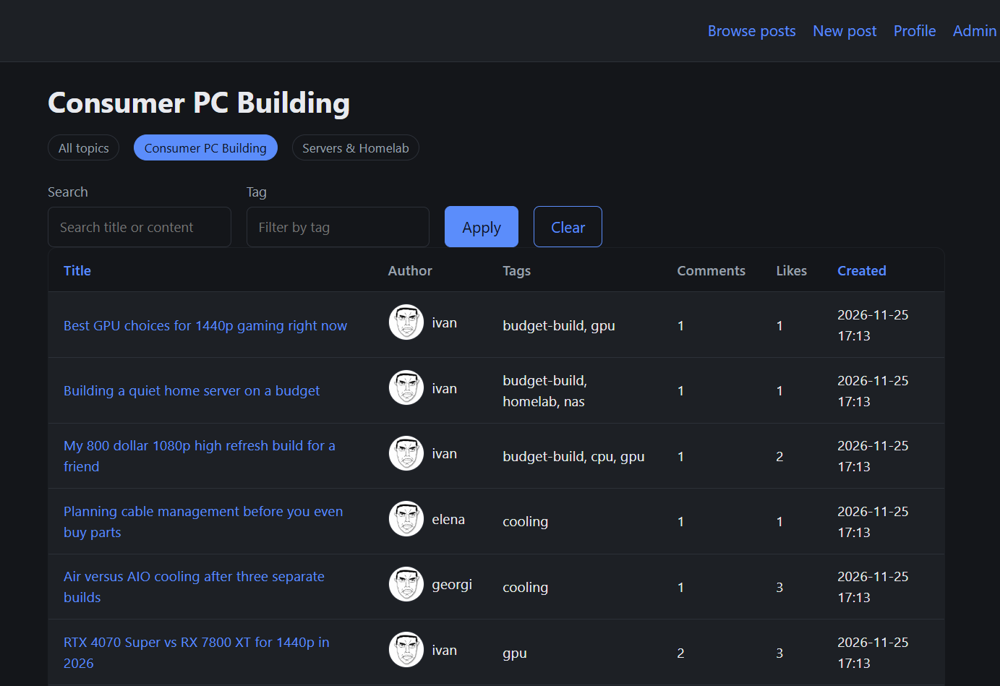

# Forum
This is my Forum System project for Telerik Academy Alpha's Java program.
It was supposed to be a team project, that had to be built within a month.
I built it alone because one teammate disapperead into the void and the other
texted me to start the project 5 days before submission, that apparently 
"It's about time to start". That is why you would find the frontend part of 
the project "a bit lacking" to say the least. I had no time.

It is a Spring Boot forum about PC building and homelabs, where users can 
create posts, comment, like and tag content. It comes with a 
server-rendered Thymeleaf frontend and a REST API documented with Swagger.


## Running it

Requires a running MariaDB instance on `localhost:3306`. The `forum` 
database gets created on first connect if it doesn't exist, and Flyway 
migrates the schema and seed data from there. DB credentials are read 
from `FORUM_DB_USERNAME` / `FORUM_DB_PASSWORD` (both default to `root`), 
see `application.yml`.

```
mvn spring-boot:run
```

Once it's running go to http://localhost:8080. You can register a new 
account or log in with one of the seeded ones (`admin` for the admin 
panel, `ivan` / `elena` for regular users). The REST API is documented at 
http://localhost:8080/swagger-ui.html.



## Docs

- [req.md](req.md) - 
  the original project requirements


- [TECHNICAL_OVERVIEW.md](TECHNICAL_OVERVIEW.md) - 
Serves as documentation and a needed deliverable.
